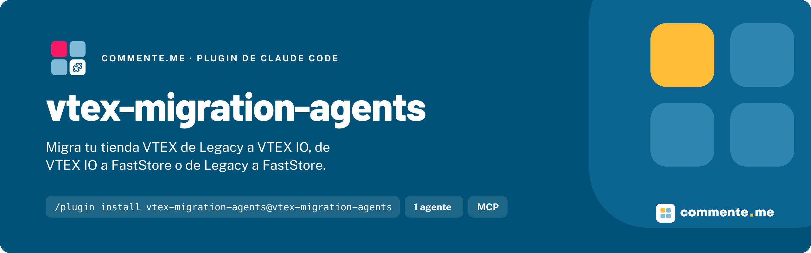

<p align="center">
	
</p>

# vtex-migration-agents

**Un subagente de Claude Code que migra tu tienda VTEX de Legacy a VTEX IO, de VTEX IO a FastStore o de Legacy a
FastStore, con el servidor MCP vtex-io-mcp incluido.**

[](./CHANGELOG.md)
[](./LICENSE)

## Instalación

```bash
/plugin marketplace add commentemeapp/vtex-migration-agents
/plugin install vtex-migration-agents@vtex-migration-agents
```

Reinicia Claude Code o corre `/reload-plugins`. El agente aparece en el typeahead de `@` como
`vtex-migration-agents:vtex-migrator`, y el servidor MCP como `vtex-io`.

## Uso rápido

Abre una sesión con el agente en el repositorio de la tienda:

```bash
claude --agent vtex-migration-agents:vtex-migrator
```

```
que generación de VTEX es este repositorio y a que conviene migrarlo
```

Así te puede preguntar el destino y pedirte el OK del plan sin intermediarios. Como subagente
(`@vtex-migration-agents:vtex-migrator`) no te puede preguntar: se detiene después del diagnóstico o del plan, y la
conversación principal te hace las preguntas.

## Que incluye

El agente trabaja en cuatro fases, siempre en este orden:

| Fase        | Que hace                                                                                                                       |
| ----------- | ------------------------------------------------------------------------------------------------------------------------------ |
| Diagnóstico | Lee el repositorio y dice si es Legacy CMS Portal, Store Framework, FastStore u otra cosa, con los archivos que lo prueban.    |
| Pregunta    | Te ofrece solo los destinos que tienen sentido desde ese origen, con su recomendación, y pregunta lo que el código no muestra. |
| Plan        | Equivalencias pieza por pieza, lo que no migra solo (contenido, Edition App, tickets a soporte), fases, riesgos y pendientes.  |
| Ejecución   | Con el plan aprobado, escribe el código nuevo en una rama propia, separado del storefront actual, y valida cada fase.          |

| Origen            | Destino         | Base                                                                     |
| ----------------- | --------------- | ------------------------------------------------------------------------ |
| Legacy CMS Portal | Store Framework | Guía oficial de VTEX: Legacy CMS Portal a Store Framework                |
| Store Framework   | FastStore       | Guía oficial de VTEX: Store Framework a FastStore                        |
| Legacy CMS Portal | FastStore       | No hay guía oficial de punta a punta: junta las dos y lo dice en el plan |

Nunca toca la tienda real. No corre `vtex publish`, `vtex deploy`, `vtex workspace promote` ni `vtex install` o
`vtex link` en master, no sube el schema del CMS a producción, no cambia DNS, no abre tickets, no hace push a ramas
compartidas y no escribe en `main` ni en `master`. Cuando el plan llega a uno de esos pasos, te deja el comando exacto
y dice quién lo corre.

| Agente          | Skills que precarga                                                                                                                   | Servidor MCP       | Modelo |
| --------------- | ------------------------------------------------------------------------------------------------------------------------------------- | ------------------ | ------ |
| `vtex-migrator` | `vtex-io-storefront-theme-app`, `vtex-io-render-runtime-and-blocks`, `faststore-storefront`, `architecture-well-architected-commerce` | las 9 herramientas | opus   |

Las demás skills de VTEX entran cuando el caso las pide: versionado de themes, React de storefront, i18n, BFF,
checkout e Intelligent Search headless, Master Data y seguridad.

## Por que existe

Migrar un storefront VTEX empieza siempre con la misma pregunta: que tengo y a dónde voy. La respuesta está en el
código, pero hay que saber leerla, y el plan depende de cosas que no están en el código, como el contenido, la
Edition App y los tickets a soporte. Este agente hace esa lectura, pregunta lo que falta y sigue las guías oficiales
de VTEX. Construido sobre las [skills oficiales de VTEX](https://github.com/vtex/skills), sin costo y de código
abierto.

## Documentación

### Requisitos

- Claude Code con soporte de plugins.
- Node `>= 18`, para que `npx` ejecute el servidor MCP.
- Las skills oficiales de VTEX, con `gh skill install vtex/skills` o `npx skills add vtex/skills`. Con
  `--scope user` quedan en todos los proyectos. Sin ellas el agente funciona, pero el mapa de equivalencias pierde
  precisión.

### Junto con vtex-io-agents

Este plugin no reemplaza a [vtex-io-agents](https://github.com/commentemeapp/vtex-io-agents). Los dos traen el servidor
MCP `vtex-io`, cada uno con su prefijo, y pueden estar instalados a la vez. En una migración a Store Framework,
`vtex-io-agents:vtex-reviewer` y `vtex-io-agents:vtex-qa` revisan y validan lo que escribió `vtex-migrator`.

### Actualizar y desinstalar

| Acción      | Comando                                                         |
| ----------- | --------------------------------------------------------------- |
| Actualizar  | `/plugin marketplace update vtex-migration-agents`              |
| Desinstalar | `/plugin uninstall vtex-migration-agents@vtex-migration-agents` |

### Estructura

```
.claude-plugin/marketplace.json       catálogo del marketplace de Claude Code
plugins/vtex-migration-agents/
	.claude-plugin/plugin.json          manifiesto del plugin; mcpServers apunta a .mcp.json
	.mcp.json                           el servidor MCP vtex-io: npx -y @commenteme/vtex-io-mcp
	agents/vtex-migrator.md             el agente
docs/agente.md                        por que el agente es como es
scripts/verificar.sh                  gate del repositorio
scripts/probar-mcp.mjs                arranca el servidor MCP y comprueba las herramientas que usa el agente
assets/                               header del README
```

### Desarrollo

Necesitas **Node >= 20**.

```bash
git clone https://github.com/commentemeapp/vtex-migration-agents.git
cd vtex-migration-agents
npm ci
./scripts/verificar.sh
node scripts/probar-mcp.mjs
claude --plugin-dir ./plugins/vtex-migration-agents
```

`scripts/verificar.sh` es el gate, el mismo del CI: JSON válido, la misma versión en los tres manifiestos, la
configuración del servidor MCP, el frontmatter del agente, `claude plugin validate --strict`, Prettier, `bash -n` y
una búsqueda de rastros. Como el agente escribe archivos, el gate exige también que las acciones prohibidas estén
escritas en su cuerpo. La versión vive en tres lugares (las dos de `.claude-plugin/marketplace.json` y `plugin.json`):
súbela en los tres a la vez.

## Contribuir · Licencia

Conventional Commits, rama desde `dev` y PR contra `dev`.
[MIT](./LICENSE).

---

Hecho por [commente.me](https://www.commente.me) · hablecon@commente.me
